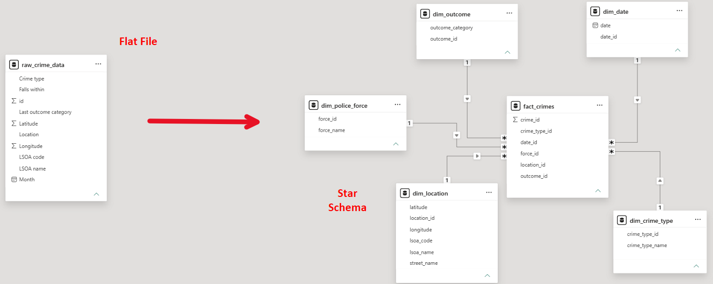

# Flat File to Relational Database - UK Crime data
## Project Summary

This project transforms monthly UK crime data taken from data.police.uk into a PostgreSQL star schema,  
using a repeatable Python ETL script.

## Tech Stack
* PostgreSQL
* Python - pandas, sqlalchemy

## Data Sources

https://data.police.uk/

Contains public sector information licensed under the Open Government Licence v3.0. 

## Design Decisions 

<ins>**Join performance:**<ins> 

The fact table initially joined to `dim_location` using `IS NOT DISTINCT FROM`, to guard against possible nulls in `dim_location`.   
That particular join encompassing 95,000 rows took 6 minutes to complete. I discovered PostgreSQL can't use hash joins or indexes with `IS NOT DISTINCT FROM`, which prolongs the query. I confirmed `dim_location` didn't have nulls, switched to a `=` join and added a `NOT NULL` constraint in the setup for all dimension tables to accommodate this change. The same join now takes 7.4 seconds to run.

<ins>**Repeatable monthly loads:**<ins>

Each run loads the new CSV into a staging table that is replaced every time, so the cleaning steps in the SQL script run fresh on each month's data. The dimension inserts use `ON CONFLICT DO NOTHING`, so only genuinely new values get added, and the fact table receives that month's rows.  

<ins>**Indexes:**<ins>

I created one index per foreign key on `fact_crimes` instead of a single composite index, so analytical queries can use any combination of columns. Indexes were created once in the database setup, and are updated with each insert.

## How to run it

1. Install PostgreSQL and Python.
2. Install the packages: pip install pandas sqlalchemy psycopg2-binary
3. Create a database called crime_data and run sql/Database_setup.sql once to create the tables.
4. Download a monthly street-level crime CSV from [data.police.uk](https://data.police.uk/).
5. Open etl_pipeline.py and replace the file path, password and port with your own values.
6. Run etl_pipeline.py from the main folder.

For each month, repeat steps 4 to 6.

## Limitations

<ins>**Running the script twice for the same month duplicates that month's data in `fact_crimes`:**<ins>

The dimension tables are protected by `ON CONFLICT DO NOTHING`, but the fact table has no duplicate check,   
so each month should only be loaded once. 

<ins>**Rows with missing values still load in the fact table:**<ins>

`NOT NULL` constraints protect the dimension tables, but the fact table's foreign keys can be null. If future data has a null in `Month`, `Crime type`, `Falls within` or `LSOA code`, that row loads with a NULL in the foreign key instead of failing.  
I allowed the nulls because a row with a missing value is still useful for queries that don't involve that particular field,  
but it will drop out of any inner join with a corresponding dimension table.

<ins>**The process is manual:**<ins>

Each monthly CSV is downloaded, loaded and transformed manually with no scheduling.
